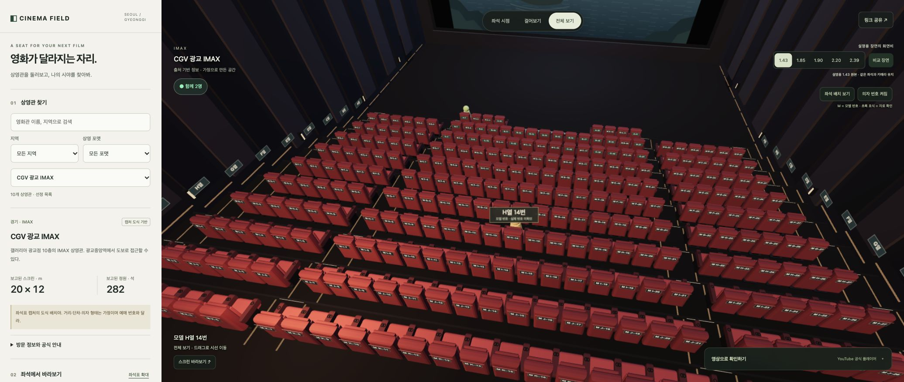

# Cinema Field

[공개 사이트 열기](https://eddy961206.github.io/cinema-field-seoul/) · [자료 조사 기록](docs/RESEARCH.md)

서울·경기 특별관 10곳을 찾아보고, 가정으로 만든 3D 공간에서 좌석 시야와 화면비를 비교하는 한국어 웹앱이다. 로그인 없이 열 수 있다.



## 이용하기

1. 영화관을 검색하거나 지역·상영 포맷을 고른다.
2. 좌석표·행·번호 메뉴에서 자리를 고른다. `좌석 배치 보기`는 의자와 번호를 내려다보며 확인하는 시점이다.
3. `이 좌석에 앉기`로 시야를 확인한다. 화면을 드래그하면 둘러볼 수 있고, 걸어보기에서는 WASD·방향키·화면 조이스틱으로 이동한다.
4. 최대 세 자리를 비교표에 담거나 같은 카메라에서 화면비를 바꿔 본다. 거리·행 간격·단차의 가정도 조정할 수 있다.
5. `새 모임 링크`를 복사해 다른 사람에게 전달한다. 같은 모임·상영관을 열면 각자가 선택한 좌석에 단순한 캐릭터가 표시된다. 기본 모임은 상영관별 공개 모임이다.

## 실제 정보와 모델의 차이

- 선정 목록이며 서울·경기 전체 영화관을 다루지 않는다. 카탈로그 11개 기록 중 종료된 판교는 탐색 목록에서 제외한다.
- 용산·왕십리·광교의 624/268/282개 모델 위치는 2026년 8월 좌석표 캡처의 도식 셀을 옮긴 것이다. 실제 좌석 표기 중 이미지에서 읽을 수 있는 **44개**만 원문 번호로 표시했다. 나머지는 **M 표기가 붙은 모델 번호**다. 녹색 표식은 자료에서 확인한 번호다. 현재 예매 화면과 대조해야 한다.
- 나머지 상영관은 개념 배치다. 공간 치수, 스크린 하단, 곡률, 단차, 좌석 폭·형태, 시선 높이는 현장 실측이 없다. 수치와 시야는 조정 가능한 가정으로 계산한다.
- 치수 미확인 상영관은 공통 28 × 12m 모델을 사용한다. 코엑스의 Dolby Cinema 전환 전 M관 치수는 현행 계산에서 제외했다. 월드타워의 과거 치수·곡면 스크린도 현재 실측처럼 취급하지 않는다.
- 스크린 치수·정원에는 자료 시점과 출처를 표시한다. 주소·교통·공식 안내를 보강했으며 요금·실시간 상영시간표·예매 재고는 수집하지 않는다.
- 화면비 비교는 직접 만든 설명용 장면에 적용된다. 16:9 원본에 없는 장면을 복원하지 않는다. 양안 시야·HDR·실제 음향·관객 가림·좌석 안락함·ScreenX 측면 영상은 재현하지 않는다.

## 실제 접속자와 개인정보

별도 서버 계정 없이 공개 Nostr 중계 서비스에 HTTPS WebSocket으로 연결한다. 각 페이지는 새 임시 서명 키를 만들고, 선택 좌석과 참가·퇴장 상태만 공유한다. 이름·카메라·마이크·영상 주소·카메라 이동은 전송하지 않는다. 탭 하나는 한 명으로 표시되며 같은 좌석에 여러 명이 앉을 수 있다. 본인을 포함해 최대 33명을 표시하는 소규모 모임 용도다.

좌석 메시지는 모임과 상영관에서 파생한 AES-GCM 키로 암호화하고, 서명과 시각·순서를 검사한다. `새 모임 링크`에는 무작위 모임 식별자가 포함된다. 링크 소유자는 참가할 수 있으며 사용자 인증·접근권한 관리 기능은 없다. 기본 공개 모임의 식별자는 누구나 알 수 있다. 중계 운영자에게 IP 등 연결 메타데이터는 보인다. NIP-01의 임시 이벤트를 사용하지만 제3자의 로그·보관 정책을 통제하거나 보관하지 않음을 보증하지 않는다.

세 중계 서비스 중 사용 가능한 연결을 이용하며 서비스 장애·차단망에서는 접속이 지연될 수 있다. 실패·인터넷 끊김·재연결·나가기 상태를 표시한다. 10초 간격으로 생존 상태를 보내고 45초 동안 갱신되지 않은 사람은 제외한다. 브라우저 절전·백그라운드 제한 때문에 열린 탭도 잠시 사라질 수 있다. 사이트 전체의 총 방문자 수나 사람의 신원을 집계하지 않는다. 분석·추적 쿠키나 서버 데이터베이스는 없다. YouTube는 영상 열기를 선택할 때만 연결한다.

## 개발 및 검증

Node.js 24 이상과 Python 3을 사용한다.

```sh
npm ci
npm run build
npm run check
npm test
python3 -m http.server 4173 --bind 127.0.0.1 --directory dist
```

`dist/`는 정적 웹앱 소스이자 배포 폴더다. Three.js는 라이선스와 함께 포함한다. `src/presence-crypto.js`와 고정 버전의 `@noble/secp256k1`을 `npm run build`로 묶어 브라우저용 라이브러리를 만든다. 비밀 키나 환경변수를 저장소에 넣을 필요가 없다.

검증은 정적 참조·카탈로그 출처·좌석 도식·모델 계산·화면비·공유 링크·외부 영상 URL·접속 메시지 검사를 포함한다. 실제 브라우저에서는 데스크톱·모바일 화면, 좌석 선택, 비교, 공유, 두 탭의 실제 중계 연결과 좌석 갱신·퇴장을 확인한다. 화면 및 검증 범위는 [검수 기록](docs/QA.md)에 남긴다. 모든 iOS 기기·브라우저나 모든 네트워크의 동작을 보증하는 검증은 아니다.

## 배포

`main`에 푸시하면 GitHub Actions가 의존성 설치·빌드·검사·테스트를 실행한다. 통과한 `dist/`를 GitHub Pages에 배포한다. PR에서는 검사만 실행한다. 사이트 경로는 `/cinema-field-seoul/`이며 상대 경로를 사용한다.

출처별 원문과 확인 한계는 [RESEARCH.md](docs/RESEARCH.md), 배포 절차는 [.github/workflows/pages.yml](.github/workflows/pages.yml)에서 확인할 수 있다.
