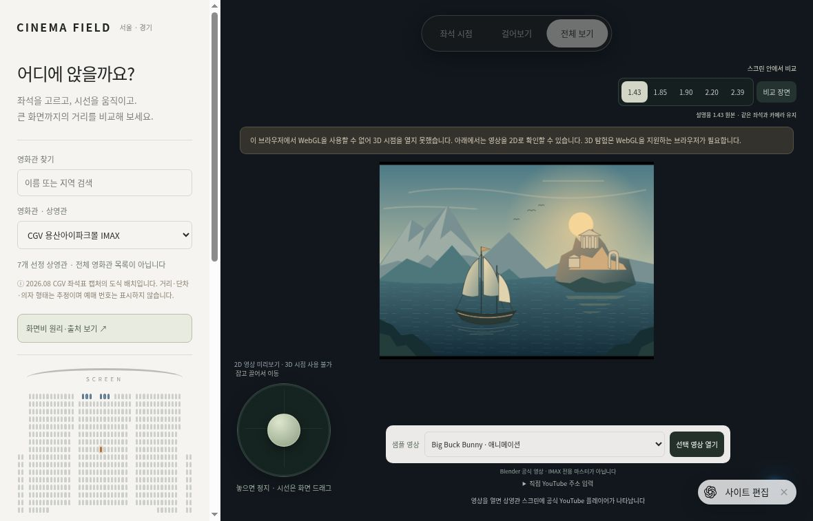

# Cinema Field

## 화면 미리보기

실제 브라우저의 좌석 선택·화면비 비교 UI. WebGL이 비활성화되어 2D 대체 화면이며, 정상 3D 렌더 캡처가 아닙니다.

A Korean-language, browser-local 3D auditorium exploration app. Static source lives in `dist/`; Three.js is vendored with its MIT license. No build step, backend database, video extraction, analytics or saved user inputs.

## Data boundaries

The catalog is a selected subset, not an exhaustive Seoul/Gyeonggi theater directory. Yongsan, Wangsimni and Gwanggyo grids transcribe schematic seat-cell positions observed in August 2026 operator-UI screenshots linked by Staircrusher Club. Ordinal model positions are not booking labels. Distances, risers, seat furniture, auditorium envelope and eyeheight are assumptions, never surveyed physical measurements. Other rooms use conceptual layouts. Screen-size and capacity claims include provenance and historical/secondary qualifiers in the interface.

WorldTower's current 295-seat count replaces legacy counts; its curved/tilted screen is simplified to a plane. Yeongdeungpo is the current ScreenX room, not former Starium. Pangyo is excluded from the selectable catalog following reported closure. Human binocular perception, HDR, actual acoustics, audience occlusion and multi-surface ScreenX are not reproduced.

## Verification

Syntax checks: `node --check dist/app.js` and `node --check dist/scene.js`.

Model-level verification confirms 624/268/282 positions, captured schematic gaps, field-of-view reset, movement direction, and empty wheelchair platform handling. This does not constitute GPU, browser interaction, YouTube playback or responsive visual verification. Actual hosted-browser QA is required before calling the app complete.
