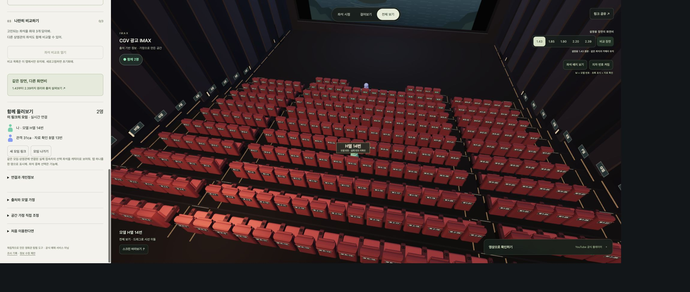
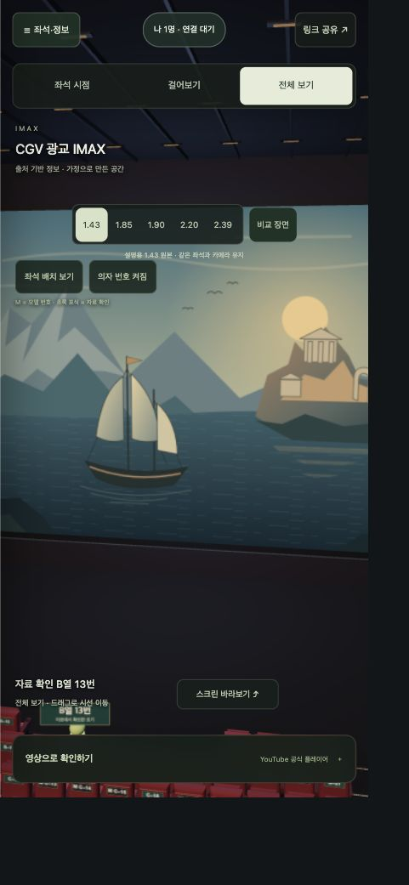
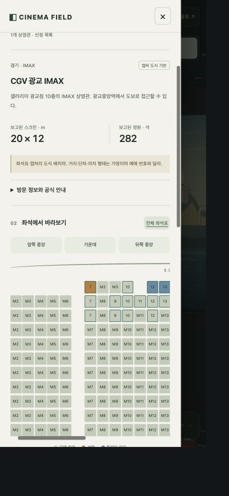

# 화면 및 동작 검수

검수일: 2026-10-15 (Asia/Seoul). 연결된 Chrome에서 로컬 사이트를 직접 조작했다. Product Design의 화면·접근성 검수 기준을 적용했다. 개발자 도구로 화면만 그린 테스트나 가상 접속자를 사용하지 않았다.

## 1. 실제 접속자와 의자 번호 — 통과

두 탭이 외부 Nostr 중계를 통해 연결됐다. 한쪽의 F열 12번을 D열 15번으로 바꾸자 다른 탭의 목록과 캐릭터가 바뀌었다. 모임 나가기는 상대 목록을 2명에서 1명으로 갱신했다. 다른 상영관으로 이동했을 때 분리됐고, 새 무작위 모임 링크를 열었을 때 다시 연결됐다. 위 화면은 같은 모임에서 H열 모델 14번과 자료 확인 B열 13번을 선택한 두 접속자다.

의자 앞·뒤의 열과 번호, 벽의 행 표식, 선택 좌석 표식을 확인했다. `좌석 배치 보기`와 `스크린 바라보기`는 서로 다른 카메라 방향으로 작동했다. 무대의 클릭이 시점을 초기화하던 이벤트 전파 오류를 고쳤다. 초록 표식과 M 접두어뿐 아니라 텍스트로도 자료 확인/모델을 구분한다.

## 2. 모바일 상영관 화면 — 통과, 실제 iOS 기기 미검증

측정된 CSS 화면 433 × 937에서 문서 가로 넘침이 없었다. 접속 배지가 화면비 버튼과 겹치던 부분을 상단으로 옮겼다. 모바일 시점·좌석 배치·번호·화면비 버튼의 높이를 키웠다. 좌석·정보 패널은 대화상자로 열리고 무대는 비활성화된다. 닫은 뒤 패널은 비활성화되고 좌석·정보 버튼으로 초점을 돌려준다.

이 검사는 Chrome의 화면 크기 변경을 사용했다. Safari, VoiceOver, 실제 iPhone의 터치·발열·메모리·절전 동작은 검증하지 않았다. 어두운 3D 장면의 작은 번호는 가까이 보거나 큰 화면에서 확인해야 한다. 전체 접근성 준수 인증은 아니다.

## 3. 모바일 좌석 선택과 출처 구분 — 통과

검색으로 안성 한 곳만 표시한 뒤 광교로 바꿨다. A행의 첫 모델 위치를 선택했을 때 실제 자료 표기 A열 7번이 표시됐다. 확대 좌석표에서 확인된 번호와 M 번호를 읽을 수 있고 가로 스크롤로 이동한다. 행·번호 메뉴로도 선택할 수 있다. `이 좌석에 앉기`는 선택 좌석으로 시점을 바꾸고 모바일 패널을 닫는다.

## 함께 확인한 동작

- 지역·포맷·검색 조합, 검색 결과 없음과 조건 초기화, 종료된 판교 제외.
- 모델 3자리 비교표·중복 방지·삭제·설정 복원, 치수 미확인 상영관의 구분.
- 첫 줄 거리 변경과 계산값·공유 URL 갱신, 화면비 전환, 설명용 원본과 16:9 원본의 크롭·여백 계산.
- 상영관·좌석·화면비·가정·모임을 보존하는 공유 링크와 복사, 영상 주소·비교 목록 제외.
- 잘못된 영상 주소 거부. 공식 YouTube nocookie iframe 생성과 외부 열기 링크를 확인했다. 실제 영상 재생 완료는 확인하지 않았다.
- 관련 자동 검사 14개: 공유 링크의 경계값, 허용 영상 주소, 좌석 도식과 휠체어 위치, 2D/3D의 같은 좌표, 44개 원문 좌석 표기, 화면비, 모임 분리·암호문 서명·변조·시각·선택 범위 검사.

## 남는 한계

실제 예매 좌석과 공간의 완전한 재현은 확보한 자료만으로 확인할 수 없다. 미확인 번호·공간 치수·기하·의자 모양은 모델로 표시한다. 공개 중계 서비스의 계속된 가용성이나 모든 회사망·국가·기기에서의 연결을 보증하지 않는다. 종료·절전한 접속자는 최대 약 45초 동안 남을 수 있다. WebGL 연결 손실과 시작 실패의 대체 화면은 코드에 있지만 이번 브라우저에서 강제로 장애를 발생시키지는 않았다.
